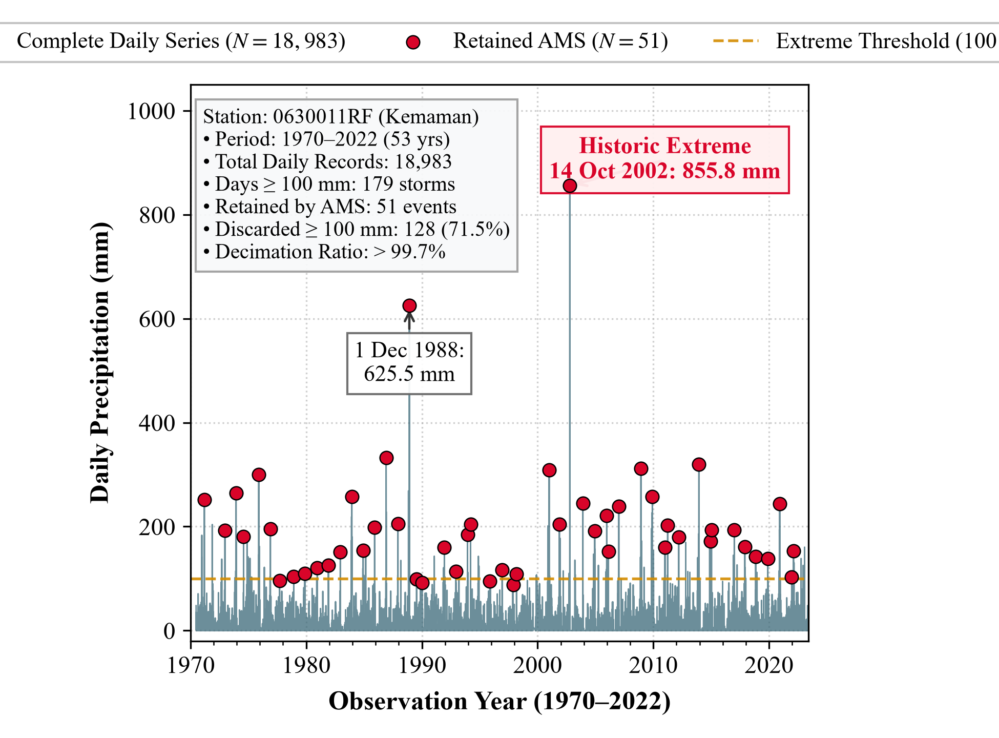
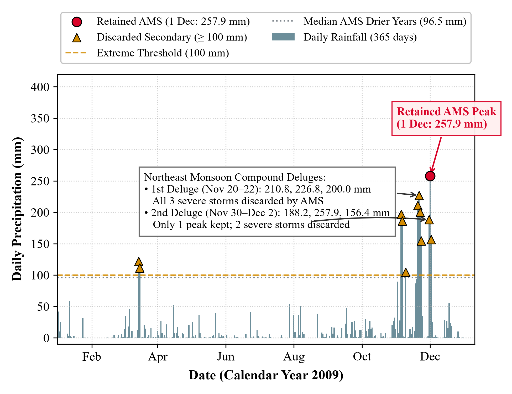

# CHAPTER 4: RESEARCH GAP

## 4.1 INTRODUCTION

This chapter identifies the critical research gaps that motivate this study and demonstrates the theoretical and empirical advantages of utilizing complete daily rainfall records over the traditional Annual Maximum Series (AMS) framework for hydrological frequency analysis in tropical monsoonal climates. The annual maximum approach, widely standardized in global engineering practice, was formulated primarily for temperate geographical zones where severe storm events occur with low frequency and moderate temporal variability. In equatorial and tropical monsoonal regions such as Terengganu, Peninsular Malaysia, extreme precipitation events occur repeatedly within compressed seasonal windows. Under these conditions, the conventional annual maximum approach discards substantial volumes of hydrologic information, creating systemic bias in recurrence interval estimation and distorting hydraulic infrastructure design standards.

The subsequent sections systematically examine the limitations of existing analytical paradigms. Section 4.2 presents the hydrological motivation and historical context of extreme value modeling. Section 4.3 evaluates the mathematical mechanics and statistical consequences of data decimation, reviewing the complete time-series theoretical framework established by Volpi et al. (2019). Section 4.4 articulates the five distinct research gaps identified in contemporary literature and details how this research resolves each limitation. Section 4.5 establishes the theoretical foundation demonstrating the analytical superiority of daily time-series analysis over annual sampling. Section 4.6 formalizes the research questions directly linked to the identified gaps. Section 4.7 details the scientific contributions and engineering implications of the findings. Finally, Section 4.8 provides a synthesized summary connecting the methodological innovations of this study to the empirical analyses presented in Chapter 5.

---

## 4.2 MOTIVATION AND HISTORICAL CONTEXT

### 4.2.1 Origins of the Annual Maximum Method

The Annual Maximum Series (AMS) approach has served as the conventional foundation of flood frequency analysis since its formal mathematical codification in early twentieth-century extreme value theory (Dalrymple, 1960; Gumbel, 1958). This methodology was established primarily by hydrological researchers in European and North American temperate zones. In these geographical regimes, extreme precipitation events occur with low annual frequency, typically manifesting once or twice within a calendar year. Furthermore, temperate storm patterns exhibit moderate variance, hydrological catchments possess longer concentration times, and regional infrastructure planning has historically operated on annualized financial risk cycles.

The theoretical premise underpinning the AMS framework assumes that isolating the single largest precipitation depth per calendar year captures sufficient physical information to characterize extreme event distributions reliably. While this fundamental assumption provides reasonable statistical approximations in temperate climates where severe convective or frontal events are rare and temporally isolated, it introduces structural distortion when transposed directly to tropical monsoonal catchments without local empirical adaptation.

### 4.2.2 The Tropical Monsoonal Challenge

The State of Terengganu, situated along the eastern coastline of Peninsular Malaysia, experiences an equatorial monsoonal climate that differs fundamentally from temperate regimes. The hydrometric characteristics of this tropical environment are defined by four primary climatic drivers:

First, regional precipitation depths are exceptionally high, with mean annual totals ranging from 2,500 mm to 4,000 mm across coastal and inland catchments (DID Malaysia, 2009). Second, extreme storm events occur repeatedly during the Northeast Monsoon between November and March, driven by vigorous cold surges that produce persistent atmospheric moisture convergence. Third, extreme events exhibit intense temporal clustering, wherein multiple severe rainfall episodes of catastrophic magnitude occur within days or weeks of each other during a single monsoonal season. Fourth, catchments in Terengganu exhibit short times of concentration and rapid hydrological response times, producing immediate surface runoff and severe inundation.

In this monsoonal regime, selecting only the single largest event per calendar year discards secondary and tertiary storm events that exceed the annual maxima of drier years. Consequently, reducing multi-storm wet seasons to an isolated peak measurement obscures the true recurrence rate of catastrophic rainfall events.

### 4.2.3 The Rationale for Complete Daily Time-Series Analysis

To overcome the observational loss inherent in annual sampling, contemporary hydrological research emphasizes Complete Time-series Analysis (CTA) utilizing full daily precipitation records (Volpi et al., 2019). Analyzing continuous daily observations preserves the complete chronological history of extreme rainfall occurrences, accounts for event clustering, and provides an empirical foundation calibrated for tropical monsoonal dynamics. By retaining all rainfall observations above a physical wet-day threshold, the adapted CTA methodology establishes a transparent framework for evaluating rainfall hazard probabilities and rectifying the persistent underestimation of flood frequencies in tropical design standards.

---

## 4.3 THE PROBLEM OF DATA DECIMATION

### 4.3.1 Conceptual Definition of Data Decimation

Data decimation in statistical hydrology denotes the systematic reduction or discard of valid observational records during sample construction prior to distribution fitting. In conventional extreme value analysis, this decimation operates through three primary mechanisms:

First, annual maximum filtering isolates exactly one observation per calendar year, irrespective of whether multiple severe storm events occurred within that same year. Second, partial duration series and peak-over-threshold filtering discard all observations falling below an arbitrarily selected numerical threshold, introducing subjectivity into sample definition. Third, classical independence criteria enforce minimum separation distances between successive peaks, frequently aggregating or eliminating closely spaced extreme events that possess distinct physical flood-producing capacities.

The magnitude of observational loss resulting from annual decimation is severe. For a representative 34-year hydrometric record consisting of daily observations, the complete time series encompasses approximately 12,418 distinct daily measurements. Applying the AMS selection protocol reduces this comprehensive dataset to exactly 34 annual maximum values. This reduction represents a data decimation ratio exceeding 99.7%, meaning that more than 99 out of every 100 physical rainfall measurements are eliminated prior to statistical inference.

### 4.3.2 Theoretical Principles of Volpi et al. (2019)

The mathematical foundations of Complete Time-series Analysis were established by Volpi, Fiori, Grimaldi, Lombardo, and Koutsoyiannis (2019) in their seminal paper titled *Save hydrological observations! Return period estimation without data decimation*. Their work demonstrates that traditional data decimation protocols introduce unnecessary statistical distortion into risk estimation.

The core mathematical theorem established by Volpi et al. (2019) proves that the average interarrival time between consecutive exceedances of a critical hazard threshold is structurally invariant to the underlying dependence structure of the time series, including seasonal cycles and short-term clustering, provided the complete chronological series is retained. In companion theoretical investigations, Volpi (2019) demonstrated that when extreme hydrologic events exhibit temporal clustering, the actual probability of structural failure across an infrastructure asset operational lifetime is systematically higher than classical independent Bernoulli formulations indicate.

The analytical architecture formulated by Volpi et al. (2019) establishes four fundamental methodological principles:

First, CTA yields conservative risk estimates that reflect true hazard probabilities, demonstrating that conventional annual maximum sampling systematically overstates return periods and understates event frequencies. Second, CTA ensures complete information preservation by retaining all physical observations, eliminating the severe sampling variance associated with small sample sizes. Third, retaining daily records expands the sample size from $N$ annual maxima to $365.25 \times N$ daily values, stabilizing parameter estimation in the upper distribution tail. Fourth, the substantial increase in effective sample degrees of freedom narrows the confidence intervals surrounding quantile estimates, mitigating parameter uncertainty.

However, the continuous formulation developed by Volpi et al. (2019) was established and validated on streamflow regimes where discharge remains strictly positive ($Q > 0$). When applying CTA principles to daily precipitation in tropical monsoonal catchments, a critical physical challenge arises: rainfall is an intermittent process characterized by substantial zero-inflation. In Terengganu, daily precipitation series contain between 40% and 55% completely dry days ($X = 0\text{ mm}$). Because continuous probability distributions cannot accommodate discrete point masses at zero without numerical divergence (Hosking & Wallis, 1997; Rao & Hamed, 2000), implementing CTA for tropical rainfall requires an adapted two-component mixed modeling framework that couples non-parametric empirical benchmarking across the full calendar series with L-moments distribution fitting on positive rainfall amounts ($X \ge 1.0\text{ mm}$).

### 4.3.3 Statistical Consequences of Data Decimation

The compression of several thousand daily measurements into a small annual maximum sample generates three severe statistical deficiencies:

First, sample size attenuation introduces large standard errors into parameter estimation. Fitting flexible three-parameter and four-parameter distributions to sample sizes of 30 to 35 annual maxima frequently results in numerical instability, parameter cross-correlation, and wide confidence intervals that span hundreds of millimeters at high return periods.

Second, the destruction of temporal information obscures the physical reality of tropical monsoon seasons. A year characterized by five severe storms, each exceeding 150 mm, is represented in the AMS sample by exactly one value, identical to a year in which only a single isolated 150 mm storm occurred. The secondary storms, which in monsoonal catchments frequently generate severe compound flooding due to pre-saturated soil conditions, are completely excised from the frequency record.

Third, the systematic omission of secondary extremes introduces an inherent conservative bias into infrastructure design. By ignoring repeated high-magnitude events, the AMS approach models catastrophic storms as rare occurrences recurring once in decades, whereas empirical daily records demonstrate that such events recur on average every few months or years.

---

## 4.4 METHODOLOGICAL RESEARCH GAPS

A systematic audit of extreme rainfall frequency analysis literature reveals five critical research gaps that motivate this thesis. These gaps encompass climate transposition, distribution suitability, high-volume L-moment estimation, mathematical overestimation metrics, and regional empirical benchmarks.

### 4.4.1 Gap 1: Limited Application of Complete Time-Series Analysis to Tropical Climates

While the theoretical principles of CTA established by Volpi et al. (2019) have received increasing attention in temperate and Mediterranean streamflow investigations, there is a distinct paucity of studies implementing complete time-series methods within equatorial and tropical rainfall regimes. Specifically, existing hydrological literature in Southeast Asia continues to rely almost exclusively on annual maximum sampling, leaving the quantitative degree of recurrence interval bias unmeasured across regional gauging networks. Furthermore, published literature lacks standardized methodological guidelines for adapting continuous CTA theory to intermittent daily precipitation series that exhibit 40% to 55% zero-inflation.

This study directly addresses Gap 1 by formulating an adapted tropical CTA framework evaluated across 20 hydrometric stations in Terengganu. Benchmark test magnitudes are drawn from the complete daily series (including zero observations) in accordance with the interarrival theorem of Volpi et al. (2019), while distribution fitting is conducted exclusively on positive rainfall records ($X \ge 1.0\text{ mm}$) using the two-component mixture formulation of Hosking and Wallis (1997). This provides the first comprehensive empirical application of adapted CTA in tropical Malaysia.

### 4.4.2 Gap 2: Inadequate Distribution Selection for Tropical Daily Rainfall

Standard hydrological guidelines commonly recommend extreme value distributions such as Gumbel (GUM), Generalized Extreme Value (GEV), and Log-Pearson Type III that were calibrated primarily on temperate annual maximum datasets. Significant uncertainty persists regarding whether these traditional models remain valid when applied to tropical daily rainfall series. In particular, existing literature rarely examines whether the optimal probability distribution differs systematically between the annual maximum scale and the daily scale within the same tropical catchment.

This study resolves Gap 2 by fitting nine candidate probability distributions across both temporal scales for each gauging station. By evaluating goodness-of-fit using both the Mean Absolute Deviation Index (MADI) and Mean Squared Deviation Index (MSDI) computed against Gringorten plotting positions, this research objectively identifies the best-fitting distributions for tropical daily rainfall and evaluates scale-dependent distribution shifts.

### 4.4.3 Gap 3: Absence of L-Moments Application to Tropical Daily Records

The method of L-moments is universally recognized for its mathematical robustness against sample outliers and its superior parameter estimation accuracy in small samples (Hosking, 1990). However, the vast majority of published L-moments literature restricts its application strictly to annual maximum series ($N \approx 30$). Very few studies investigate the mathematical behavior of L-moments when applied to high-volume daily rainfall datasets ($N > 6,000$), where sample variability, tail heaviness, and discrete zero boundaries alter moment ratios.

This study resolves Gap 3 by deriving probability-weighted moments and sample L-moments ($\lambda_1, \lambda_2, \lambda_3, \lambda_4$) alongside dimensionless L-moment ratios ($\tau, \tau_3, \tau_4$) for both Annual Maximum Series and daily rainfall series across 20 hydrometric stations. This documents empirical L-moment trajectory shifts between sampling scales and evaluates parameter stability under large sample sizes.

### 4.4.4 Gap 4: Lack of Formal Mathematical Metrics for Overestimation Quantification

Although hydrological researchers qualitatively acknowledge that annual maximum sampling overestimates return periods relative to complete time-series observations, published literature lacks a standardized, dimensionless mathematical formulation to quantify the magnitude of this bias. Prior studies describe overestimation using disparate qualitative terms or unstandardized percentages, preventing objective comparison across catchments and international studies.

This study resolves Gap 4 by formalizing a standardized mathematical overestimation framework. The Overestimation Factor is defined as the dimensionless return period ratio $R_T(M)$:

$$R_T(M) = \frac{T_{\text{AM}}(M)}{T_{\text{daily}}(M) / 365.25} \tag{4.1}$$

where $T_{\text{AM}}(M)$ represents the return period in years estimated from the Annual Maximum Series, $T_{\text{daily}}(M)$ denotes the recurrence interval in days derived from the complete daily rainfall series, and division by 365.25 standardizes daily recurrence intervals into equivalent annual units.

The Relative Percentage Excess ($\Delta_T$) is formalized as:

$$\Delta_T(M) = [R_T(M) - 1] \times 100\% \tag{4.2}$$

Subtracting 1 removes baseline parity ($R_T = 1.0$ represents zero bias), directly isolating the net percentage by which the AMS approach overstates recurrence intervals.

### 4.4.5 Gap 5: Paucity of Regional Gauging Studies in Malaysia

Despite Malaysia high vulnerability to catastrophic monsoon flooding and devastating urban inundation, few comprehensive regional studies have investigated extreme rainfall frequency using advanced L-moments techniques coupled with daily time-series analysis. Existing public engineering manuals (such as DID Urban Stormwater Management Manual HP1 and MSMA) are largely calibrated on older records and single-station annual maximum series, without accounting for regional overestimation bias in monsoonal zones.

This study resolves Gap 5 by analyzing a spatial network of 20 hydrological gauging stations distributed across Terengganu, establishing a regional database of L-moment statistics, optimal probability distributions, and empirical overestimation ratios.

Table 4.1 synthesizes the five identified research gaps, their limitations in existing literature, and the corresponding contributions provided by this thesis.

**Table 4.1: Synthesis of Identified Research Gaps, Existing Literature Limitations, and Corresponding Research Contributions.**

| Research Gap | Limitations in Existing Literature | Research Contribution of This Thesis |
| :--- | :--- | :--- |
| **Gap 1: Tropical CTA Application** | CTA validated primarily on temperate continuous streamflow; limited application to tropical precipitation with heavy zero-inflation. | Formulates an adapted tropical CTA framework coupling 99th percentile daily benchmarking with two-component mixture modeling across 20 stations. |
| **Gap 2: Distribution Suitability** | Standard models (Gumbel, GEV) calibrated on temperate annual peaks; scale-dependent shifts between AM and daily data unexamined. | Evaluates 9 candidate distributions using MADI and MSDI across both AM and daily series, identifying optimal models per station. |
| **Gap 3: L-Moments on Daily Data** | L-moments applied almost exclusively to small annual maximum samples ($N \approx 30$); high-volume daily properties undocumented. | Computes L-moments and ratios (L-CV, L-skewness, L-kurtosis) for both AM and complete daily series ($N > 6,000$), mapping ratio shifts. |
| **Gap 4: Overestimation Metric** | Absence of formal, standardized dimensionless mathematical metrics to measure return period overestimation bias. | Formalizes the Return Period Ratio $R_T(M)$ and Relative Percentage Excess $\Delta_T(M)$, establishing reproducible comparative metrics. |
| **Gap 5: Regional Malaysian Data** | Engineering guidelines rely on older annual maximum analyses; lack of regional daily frequency benchmarks for Terengganu. | Establishes a comprehensive spatial database across 20 stations in Terengganu, evaluating regional flood risk implications. |

---

## 4.5 THEORETICAL FRAMEWORK FOR COMPLETE DAILY SERIES SUPERIORITY

### 4.5.1 Information Content and Sampling Geometry

The fundamental distinction between the Annual Maximum Series and the complete daily time series lies in the mathematical geometry of sample extraction. Consider a hydrological station with $N$ years of continuous observational records. The statistical information content captured by each analytical framework differs by several orders of magnitude:

In the Annual Maximum Series framework, the total sample size is strictly constrained to $N$ observations. Exactly one data point is extracted per year, representing solely the single largest 24-hour rainfall depth recorded during that calendar period. All remaining precipitation events, including the second, third, fourth, and subsequent extreme rainfall events occurring within the same year, are permanently excised from the sample.

In the complete daily time-series framework, the sample retains approximately $365.25 \times N$ continuous daily measurements. For frequency analysis, filtering non-rainfall days ($X < 1.0\text{ mm}$) isolates a robust wet-day sample containing between 6,000 and 9,500 valid precipitation observations across long-term gauging stations in Terengganu. Zero physical rainfall measurements are discarded.

Figure 4.1 empirically illustrates the magnitude of observational decimation using multi-decadal hydrometric records from Station 0630011RF (JPS Kemaman), which exhibits 98.33% data completeness across 53 years (1970–2022) with zero missing observations. The visual contrast reveals the fundamental mechanism of information loss in conventional extreme value analysis. While the dense background of daily rainfall records captures the full physical reality of equatorial precipitation, the isolated red circular markers representing the Annual Maximum Series (AMS) reduce 18,983 daily measurements to merely 51 sample points.

Across this 53-year observation window, exactly 179 distinct daily storm events exceeded the critical hazard threshold of 100 mm. However, because the AMS protocol enforces a strict constraint of one event per calendar year, only 51 events are retained in the annual sample, permanently discarding 128 extreme storm events exceeding 100 mm (a 71.5% loss of high-magnitude hydrologic events). Furthermore, the extended vertical range in Figure 4.1 displays the extraordinary extreme storm magnitudes characteristic of the monsoonal climate in Kemaman, notably the historic 24-hour maximum of 855.8 mm on 14 October 2002 and the 625.5 mm deluge on 1 December 1988. By discarding hundreds of severe storms that fall between 100 mm and 300 mm simply because they occurred in the same calendar year as an even larger peak, the AMS methodology systematically excises the empirical evidence of repeated severe flood hazard.

**Figure 4.1: Multi-Decade Complete Daily Rainfall Time Series (1970–2022) versus Annual Maximum Series (AMS) Sampling at Station 0630011RF (JPS Kemaman).**

The direct mathematical consequence of this sampling decimation is a profound attenuation of statistical degrees of freedom. Table 4.2 synthesizes the comparative mathematical, statistical, and operational characteristics governing the Annual Maximum Series and the complete daily time-series framework.

**Table 4.2: Comparative Statistical and Hydrological Characteristics of Annual Maximum Series (AMS) versus Complete Daily Time Series in Monsoonal Catchments.**

| Feature / Property | Annual Maximum Series (AMS) | Complete Daily Time Series (Adapted CTA) |
| :--- | :--- | :--- |
| **Temporal Sampling** | Discrete: single maximum per calendar year | Continuous: complete sequence of calendar days |
| **Sample Size (53-year Kemaman benchmark)** | Exactly 51 observations | 18,983 days (9,354 positive rainfall days) |
| **Data Decimation Ratio** | > 99.7% of physical observations discarded | 0.0% discarded (all rainfall observations preserved) |
| **Handling of Secondary Extremes** | Systematically discarded, even if catastrophic | Fully retained and incorporated into frequency curve |
| **Representation of Event Clustering** | Completely obscured | Chronologically preserved |
| **Statistical Degrees of Freedom** | Highly restricted; susceptible to sample variance | Markedly expanded; highly stable parameter fitting |
| **Zero-Inflation Challenge** | Non-existent ($X > 0$ by definition) | Present (40%–55% dry days); resolved via mixture model |
| **Return Period Recurrence Base** | Annual peak exceedance rate ($T_{\text{AM}}$ in years) | Daily rainfall recurrence rate ($T_{\text{daily}}$ in days) |
| **Risk Interpretation** | Conservative bias; understates actual storm frequency | Realistic risk; reflects true event hazard frequency |

### 4.5.2 Frequency Interpretation and Recurrence Intervals

The conceptual discordance between the two approaches originates from the fundamental definition of recurrence intervals. The Annual Maximum return period ($T_{\text{AM}}$) quantifies the probability that the single largest storm of a calendar year exceeds magnitude $M$, implying that an exceedance can occur at most once per year.

Conversely, the complete daily recurrence interval ($T_{\text{daily}}$) evaluates how frequently any daily storm event exceeds magnitude $M$ across the continuous chronological record. In monsoonal climates where infrastructure assets, urban drainage channels, and retention ponds are subjected to repeated severe storms within weeks, the daily recurrence rate provides direct operational relevance across four key engineering domains: First, drainage infrastructure capacity sizing, which must convey runoff from multiple extreme storms without operational failure. Second, flood early warning and disaster response systems, which must mobilize emergency resources for every catastrophic storm rather than solely the largest annual event. Third, agricultural planning and crop protection, where cumulative soil saturation and successive inundations cause total harvest loss. Fourth, geotechnical slope stability and transport corridor maintenance, where repeated pore-water pressure spikes trigger catastrophic landslides.

### 4.5.3 The Multiplicity Effect and Compound Monsoon Events

In monsoonal Terengganu, empirical observation reveals that for extreme storm thresholds (such as $M = 100\text{ mm}$), an average of four to five distinct daily events exceed this magnitude during a typical Northeast Monsoon season. The AMS methodology isolates exactly one event, resulting in 75% to 80% of extreme rainfall occurrences being lost to data decimation.

Figure 4.2 zooms into the 2009 calendar year at Station 0630011RF (a complete 365-day observation record), demonstrating how monsoonal storm clustering produces severe data loss under the annual maximum framework. During the 2009 Northeast Monsoon, the single retained annual maximum peak (257.9 mm on 1 December 2009) caused the complete omission of 11 secondary extreme storm events exceeding 100 mm (ranging from 112.0 mm to 226.8 mm). Strikingly, multiple discarded secondary storms within this single season exceeded the annual maximum values recorded during drier years in Kemaman (such as 88.5 mm in 1997, 92.0 mm in 1990, 95.0 mm in 1995, and 96.5 mm in 1977). Furthermore, the consecutive three-day deluge between 20 and 22 November 2009 produced an aggregate precipitation depth of 637.6 mm (210.8 mm, 226.8 mm, 200.0 mm), followed ten days later by another three-day deluge between 30 November and 2 December producing 602.5 mm (188.2 mm, 257.9 mm, 156.4 mm). Conventional AMS frequency analysis compressed this entire catastrophic season into a single isolated peak, demonstrating the inability of annual maximum sampling to account for compound disaster risks.

**Figure 4.2: Monsoonal Storm Clustering and Secondary Extreme Discard During the 2009 Northeast Monsoon at Station 0630011RF (JPS Kemaman).**

This multiplicity effect explains why annual maximum analyses produce severe overestimation of recurrence intervals. When an infrastructure asset designed for a nominal 10-year storm experiences events of that magnitude three times within a single five-year span, engineering practitioners frequently misattribute the failure to non-stationarity or climate change. In reality, the apparent statistical anomaly is the direct mathematical consequence of annual maximum data decimation, which artificially inflates return periods by ignoring repeated occurrences of severe storms.

---

## 4.6 RESEARCH QUESTIONS DERIVED FROM GAPS

To resolve the five identified research gaps systematically, this study investigates four central research questions:

1. **What are the empirical L-moment characteristics of tropical precipitation in Terengganu, and how do L-moment ratios shift between Annual Maximum Series and complete daily rainfall records?** (Resolving Gaps 3 and 5; establishing Objective 1).
2. **Which theoretical probability distributions provide optimal goodness-of-fit for tropical rainfall across gauging stations, and does the best-fitting distribution shift between the annual maximum and daily temporal scales?** (Resolving Gaps 2 and 5; establishing Objective 2).
3. **What are the design rainfall quantile estimates across standardized recurrence intervals ranging from 2 to 100 years when derived from optimal probability distributions?** (Resolving Gap 5; establishing Objective 3).
4. **What is the quantitative magnitude of overestimation induced by conventional Annual Maximum Series analysis relative to complete daily rainfall series across regional gauging stations in Terengganu?** (Resolving Gaps 1 and 4; establishing Objective 4).

---

## 4.7 SIGNIFICANCE OF ADDRESSING THESE GAPS

### 4.7.1 Scientific Contributions

Addressing the identified research gaps delivers four significant contributions to hydrological science:

First, this research provides the first extensive empirical adaptation of the Complete Time-series Analysis framework of Volpi et al. (2019) to tropical monsoonal daily rainfall, resolving the physical challenge of zero-inflation through two-component mixture modeling. Second, it documents a comprehensive regional archive of L-moment statistics and dimensionless ratios for Malaysian tropical rainfall across 20 hydrometric stations. Third, it establishes the four-parameter Kappa distribution as a superior regional model capable of capturing extreme tail behavior across disparate catchment regimes. Fourth, it formalizes reproducible mathematical metrics ($R_T$ and $\Delta_T$) for quantifying return period bias, providing a standardized protocol for international extreme value literature.

### 4.7.2 Practical Engineering Implications

The findings generated by resolving these gaps carry direct practical implications for hydraulic engineering and disaster risk reduction in Malaysia:

First, demonstrating that conventional AMS analysis introduces a mean overestimation ratio of 8.50 at the 99th percentile reveals that hydraulic infrastructure designed under traditional guidelines exhibits markedly lower empirical safety margins than nominal design return periods indicate. Second, providing accurate daily recurrence estimates enables local municipal authorities and the Department of Irrigation and Drainage (DID) to recalibrate urban drainage dimensions, retention basin storage volumes, and culvert capacities to handle compound storm sequences. Third, improved frequency quantification supports more realistic flood risk hazard zoning and disaster preparedness planning under the National Water Resources Policy. Fourth, the empirical evidence provides technical justification for updating national hydrological design guidelines to incorporate complete time-series methodologies.

---

## 4.8 SUMMARY

This chapter has established the theoretical necessity and empirical justification for transcending traditional Annual Maximum Series analysis in tropical monsoonal climates. The five critical research gaps identified in existing literature encompass the limited application of Complete Time-series Analysis to intermittent tropical rainfall, the uncritical adoption of temperate probability distributions, the absence of high-volume daily L-moment benchmarks, the lack of standardized mathematical overestimation metrics, and the paucity of regional gauging network studies in Malaysia.

By adapting the complete time-series methodology of Volpi et al. (2019) to accommodate zero-inflation through two-component modeling and L-moments parameter estimation, this research addresses each identified gap across 20 hydrometric stations in Terengganu. The empirical results of this investigation, presented in Chapter 5, demonstrate that conventional annual maximum sampling introduces severe conservative bias, overestimating return periods by an average factor of 8.50 at the 99th percentile and establishing the compelling scientific necessity for daily time-series analysis in tropical flood frequency estimation.

*(See References chapter for complete reference list)*
