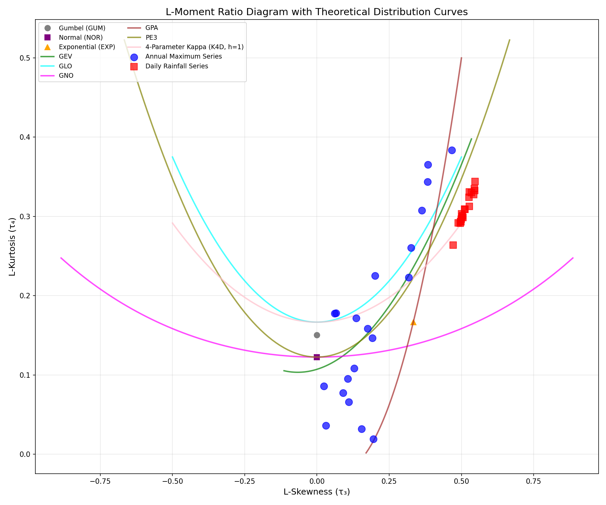
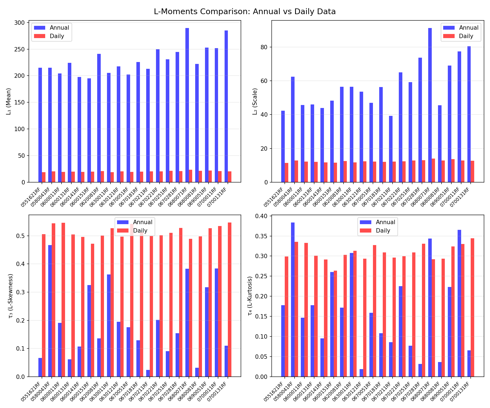
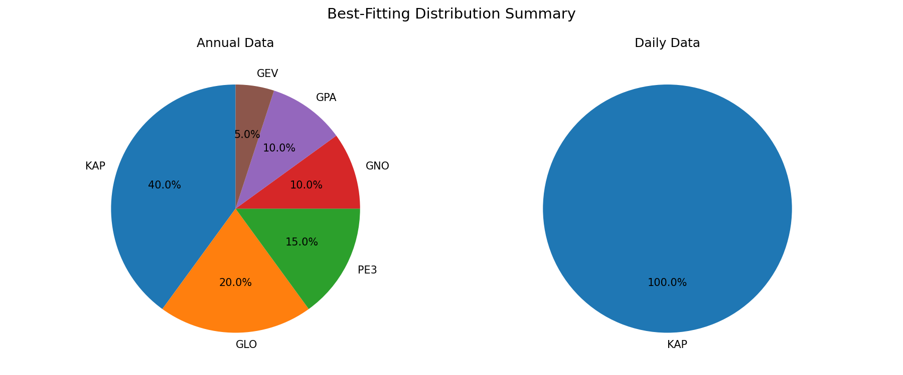
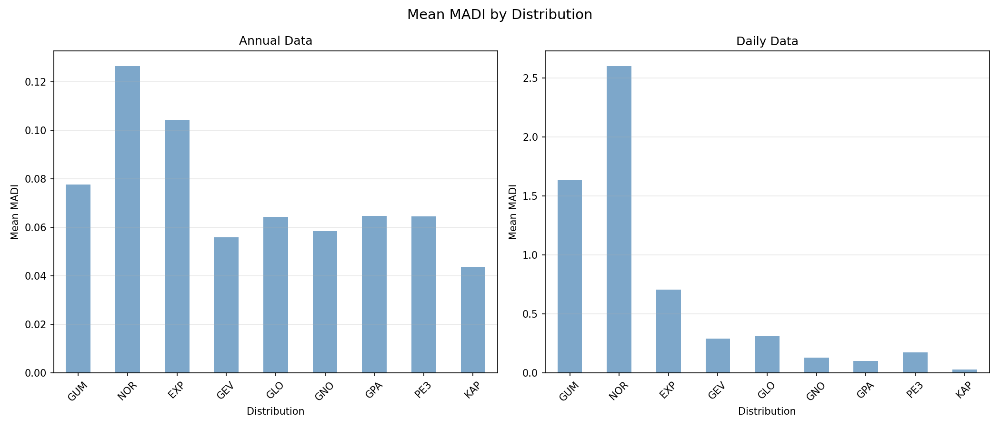
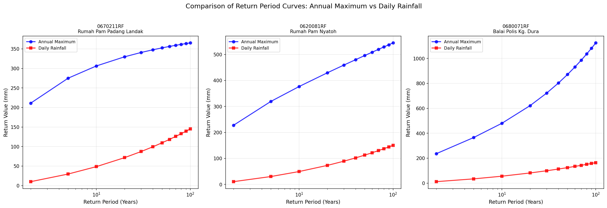
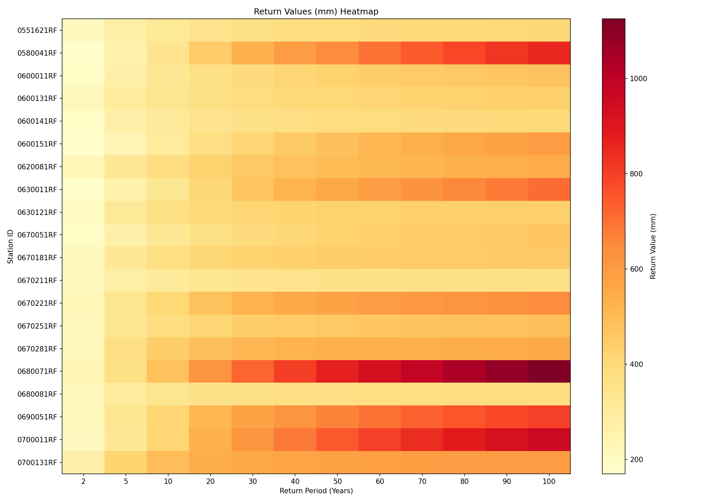
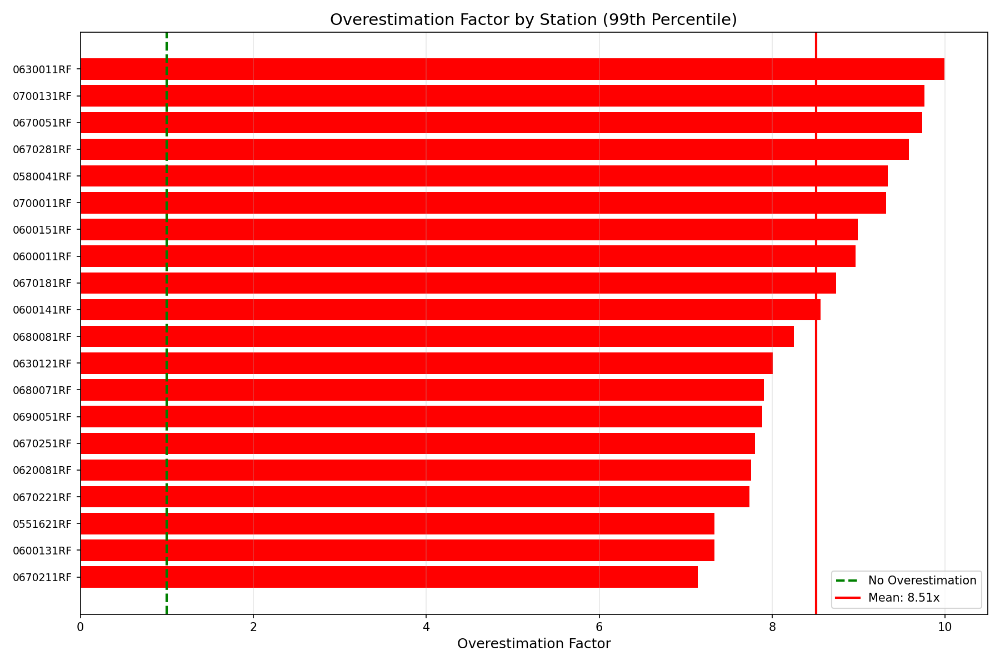
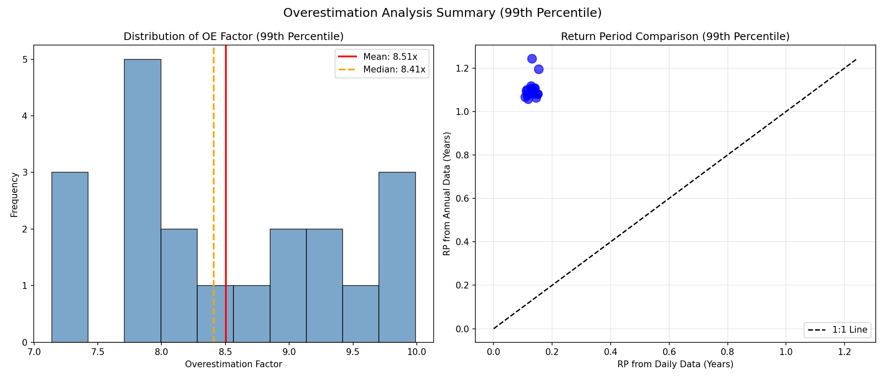
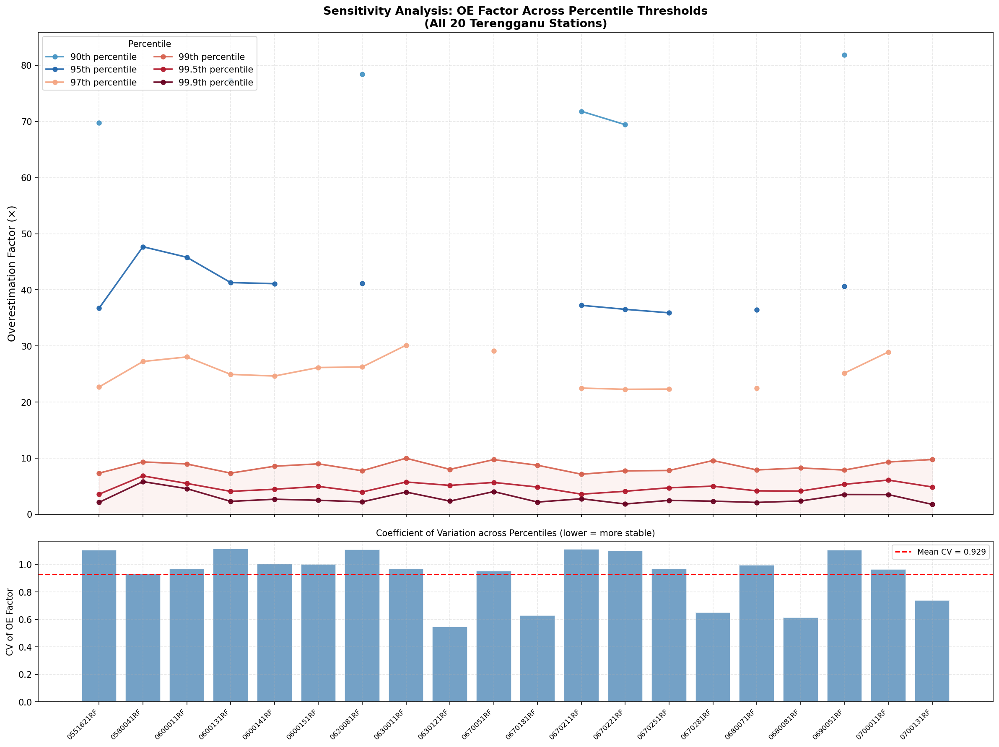
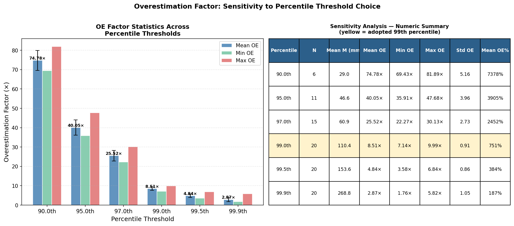

# CHAPTER 5: RESULTS AND DISCUSSION

## 5.1 Introduction

This chapter presents the results of the L-moments flood frequency analysis conducted on twenty rainfall stations in Terengganu, Malaysia. The methodology described in Chapter 3 was applied to address the four research objectives. Results are presented for both Annual Maximum Series (AMS) and daily rainfall data.

## 5.2 Objective 1: Parameter Estimation Using L-Moments

### 5.2.1 L-Moments for Annual Maximum Series

Table 5.1 presents the L-moment statistics for all twenty stations.

**Table 5.1: L-Moment Statistics for Annual Maximum Series**

| Station ID | Station Name | N | L₁ (Mean) | L₂ (Scale) | τ₃ (L-Skewness) | τ₄ (L-Kurtosis) |
|------------|--------------|---|-----------|------------|-----------------|-----------------|
| 0551621RF | Stor JPS Kuala Terengganu | 34 | 215.06 | 42.34 | 0.0663 | 0.1781 |
| 0580041RF | Klinik Bidan Kg. Baru Ajil | 37 | 214.79 | 62.37 | 0.4666 | 0.3835 |
| 0600011RF | JPS Bukit Besi | 51 | 204.43 | 45.75 | 0.1913 | 0.1467 |
| 0600131RF | JPS Dungun | 30 | 224.34 | 46.02 | 0.0615 | 0.1777 |
| 0600141RF | Rumah Pam Paya Ketam | 34 | 197.83 | 43.98 | 0.1072 | 0.0954 |
| 0600151RF | JPS Kuala Dungun | 36 | 194.89 | 48.28 | 0.3254 | 0.2606 |
| 0620081RF | Rumah Pam Nyatoh | 41 | 241.32 | 56.44 | 0.1358 | 0.1717 |
| 0630011RF | JPS Kemaman | 51 | 205.46 | 56.54 | 0.3630 | 0.3075 |
| 0630121RF | JPS Kg. Ibok, Kemaman | 33 | 217.38 | 53.61 | 0.1947 | 0.0191 |
| 0670051RF | Rumah Pam Tok Sabah, Marang | 45 | 202.48 | 46.97 | 0.1752 | 0.1586 |
| 0670181RF | Kg. Tepuh, Hulu Terengganu | 43 | 225.63 | 56.36 | 0.1290 | 0.1085 |
| 0670211RF | Rumah Pam Padang Landak | 41 | 213.23 | 39.24 | 0.0241 | 0.0859 |
| 0670221RF | JPS Kuala Berang | 48 | 250.02 | 64.93 | 0.2012 | 0.2253 |
| 0670251RF | Rumah Pam Jerangau | 45 | 230.93 | 59.19 | 0.0902 | 0.0773 |
| 0670281RF | Kg. Menerong, Hulu Terengganu | 35 | 244.58 | 73.69 | 0.1542 | 0.0320 |
| 0680071RF | Balai Polis Kg. Dura | 35 | 289.65 | 91.25 | 0.3827 | 0.3436 |
| 0680081RF | Rumah Pam Rantau Petronas | 43 | 222.20 | 45.53 | 0.0314 | 0.0363 |
| 0690051RF | Rumah Pam Pengkalan Ranggon | 36 | 252.72 | 69.07 | 0.3171 | 0.2231 |
| 0700011RF | Rumah Pam Besut | 39 | 251.68 | 77.43 | 0.3835 | 0.3652 |
| 0700131RF | JPS Jertih, Besut | 32 | 284.87 | 80.51 | 0.1102 | 0.0659 |

Across the twenty hydrological monitoring stations in Terengganu, the first sample L-moment ($\lambda_1$), representing the sample mean, ranges from 194.89 mm at Station 0600151RF (JPS Kuala Dungun) to 289.65 mm at Station 0680071RF (Balai Polis Kg. Dura). The second sample L-moment ($\lambda_2$), which reflects the dispersion or scale of annual extreme events, varies between 39.24 mm at Station 0670211RF (Rumah Pam Padang Landak) and 91.25 mm at Station 0680071RF. Furthermore, sample L-skewness ($	au_3$) is primarily positive across all observation sites, spanning from 0.0241 at Station 0670211RF to 0.4666 at Station 0580041RF (Klinik Bidan Kg. Baru Ajil), confirming moderate to heavy right-tail asymmetry across the regional annual maximum series. Finally, sample L-kurtosis ($	au_4$) ranges from 0.0191 at Station 0630121RF (JPS Kg. Ibok, Kemaman) to 0.3835 at Station 0580041RF, illustrating substantial cross-station variability in tail thickness and peak sharpness across the regional monitoring network.

### 5.2.2 L-Moments for Daily Rainfall Series

**Table 5.2: L-Moment Statistics for Daily Rainfall Series**

| Station ID | Station Name | N | L₁ (Mean) | L₂ (Scale) | τ₃ (L-Skewness) | τ₄ (L-Kurtosis) |
|------------|--------------|---|-----------|------------|-----------------|-----------------|
| 0551621RF | Stor JPS Kuala Terengganu | 6,391 | 18.76 | 11.38 | 0.5052 | 0.2988 |
| 0580041RF | Klinik Bidan Kg. Baru Ajil | 5,062 | 20.29 | 12.86 | 0.5446 | 0.3352 |
| 0600011RF | JPS Bukit Besi | 9,311 | 19.25 | 12.23 | 0.5462 | 0.3325 |
| 0600131RF | JPS Dungun | 6,185 | 20.01 | 12.12 | 0.5045 | 0.3012 |
| 0600141RF | Rumah Pam Paya Ketam | 6,161 | 19.52 | 11.67 | 0.4957 | 0.2915 |
| 0600151RF | JPS Kuala Dungun | 7,087 | 19.61 | 11.52 | 0.4715 | 0.2637 |
| 0620081RF | Rumah Pam Nyatoh | 8,110 | 20.88 | 12.56 | 0.5005 | 0.3033 |
| 0630011RF | JPS Kemaman | 9,651 | 18.89 | 11.75 | 0.5269 | 0.3128 |
| 0630121RF | JPS Kg. Ibok, Kemaman | 6,169 | 20.57 | 12.34 | 0.4964 | 0.2936 |
| 0670051RF | Rumah Pam Tok Sabah, Marang | 6,631 | 19.23 | 12.14 | 0.5418 | 0.3277 |
| 0670181RF | Kg. Tepuh, Hulu Terengganu | 8,555 | 19.78 | 12.11 | 0.5121 | 0.3089 |
| 0670211RF | Rumah Pam Padang Landak | 8,260 | 20.21 | 12.22 | 0.4990 | 0.2965 |
| 0670221RF | JPS Kuala Berang | 9,345 | 20.35 | 12.37 | 0.5017 | 0.2994 |
| 0670251RF | Rumah Pam Jerangau | 8,458 | 21.28 | 12.93 | 0.5105 | 0.3093 |
| 0670281RF | Kg. Menerong, Hulu Terengganu | 6,206 | 20.99 | 13.00 | 0.5273 | 0.3310 |
| 0680071RF | Balai Polis Kg. Dura | 7,683 | 23.43 | 13.99 | 0.4892 | 0.2921 |
| 0680081RF | Rumah Pam Rantau Petronas | 7,620 | 21.43 | 12.87 | 0.4980 | 0.2933 |
| 0690051RF | Rumah Pam Pengkalan Ranggon | 5,965 | 22.13 | 13.68 | 0.5266 | 0.3242 |
| 0700011RF | Rumah Pam Besut | 5,740 | 20.68 | 12.87 | 0.5344 | 0.3303 |
| 0700131RF | JPS Jertih, Besut | 5,182 | 20.14 | 12.70 | 0.5470 | 0.3441 |

In marked contrast to the annual maximum series, the complete daily rainfall series yields a first sample L-moment ($\lambda_1$) ranging narrowly between 18.76 mm at Station 0551621RF (Stor JPS Kuala Terengganu) and 23.43 mm at Station 0680071RF (Balai Polis Kg. Dura). The daily scale metric ($\lambda_2$) remains tightly bounded between 11.38 mm and 13.99 mm across all monitoring stations. The sample L-skewness ($	au_3$) for daily wet-day precipitation exhibits pronounced right-tail asymmetry, with values consistently clustered within the narrow interval of 0.4715 to 0.5470. Because daily rainfall series retain between 5,062 and 9,651 valid wet-day observations per station, the resulting sample L-moments exhibit heightened stability and narrow confidence bounds, demonstrating that tropical daily rainfall maintains consistent structural distributional properties across Terengganu.

### 5.2.3 L-Moment Ratio Diagram

**Figure 5.1:** L-Moment Ratio Diagram comparing Annual Maximum Series (blue circles) and Daily Rainfall Series (red squares) with theoretical distribution curves. The theoretical curves represent the relationship between L-skewness (τ₃) and L-kurtosis (τ₄) for different probability distributions: Gumbel (GUM), Normal (NOR), Exponential (EXP), Generalized Extreme Value (GEV), Generalized Logistic (GLO), Generalized Normal (GNO), Generalized Pareto (GPA), Pearson Type III (PE3), and 4-Parameter Kappa (K4D). These curves help identify which theoretical distributions are most appropriate for the observed data by showing where the empirical data points fall relative to the theoretical relationships.

Inspection of the empirical L-moment ratio diagram in Figure 5.1 reveals two distinct behavioral regimes across the regional network. First, the empirical points for the Annual Maximum Series (represented by blue circles) are scattered broadly across the L-skewness domain ($	au_3 = 0.02$ to $0.47$) and L-kurtosis domain ($	au_4 = 0.02$ to $0.38$). This broad dispersion reflects the heightened sampling variability inherent in annual maximum sampling, where single isolated storms exert a disproportionate influence on sample moments in records spanning three to five decades.

Second, the Daily Rainfall Series data points (represented by red squares) cluster tightly within a compact high-skewness region ($	au_3 = 0.47$ to $0.55$; $	au_4 = 0.26$ to $0.34$). This dense clustering confirms that the underlying physical mechanism generating daily rainfall extremes maintains coherent stochastic properties across all twenty monitoring stations.

Third, comparison against theoretical distribution trajectories indicates that the daily series data points plot in immediate proximity to the 4-Parameter Kappa (K4D) curve. This graphical correspondence provides visual validation for selecting four-parameter distributions for daily rainfall modeling. Conversely, the annual maximum empirical points are dispersed across several candidate curves, with individual stations aligning variously with Generalized Logistic (GLO), Generalized Normal (GNO), Pearson Type III (PE3), and K4D distributions. This dispersion highlights the necessity of formal numerical goodness-of-fit assessment rather than relying on a single uniform regional distribution for annual maxima.

### 5.2.4 Comparative Evaluation of Sample L-Moments Between Datasets

To synthesize the structural divergence between the annual maximum series and the complete daily rainfall series, Figure 5.2 contrasts the four sample L-moments across all twenty observation stations.

**Figure 5.2:** Comparison of sample L-moment statistics between Annual Maximum Series (blue bars) and Daily Rainfall Series (red bars) across twenty stations in Terengganu. The four panels display: (a) sample mean ($\lambda_1$), (b) sample scale ($\lambda_2$), (c) L-skewness ($	au_3$), and (d) L-kurtosis ($	au_4$). The comparison illustrates the order-of-magnitude reduction in scale and mean alongside the heightened stability of skewness and kurtosis in the daily series.

### 5.2.5 Distribution Parameter Estimation

Following the calculation of L-moments, distribution parameters were estimated for all nine candidate distributions using the method of L-moments. The estimated parameters are essential for subsequent goodness-of-fit testing and distribution selection.

#### 5.2.5.1 Best-Fitting Distribution Parameters

The estimated parameters for the best-fitting distributions (identified through MADI/MSDI goodness-of-fit testing) are presented in Tables 5.3 and 5.4. These parameters were estimated using the method of L-moments as described in Chapter 3.

**Table 5.3: Estimated Parameters for Best-Fitting Distributions (Annual Maximum Series)**

| Station ID | Station Name | Distribution | Parameter 1 | Parameter 2 | Parameter 3 | Parameter 4 |
|------------|--------------|-------------|-------------|-------------|-------------|-------------|
| 0551621RF | Stor JPS Kuala Terengganu | PE3 | loc = 215.06 | scale = 75.44 | skew = 0.4063 | - |
| 0580041RF | Klinik Bidan Kg. Baru Ajil | GEV | loc = 150.38 | scale = 50.89 | - | - |
| 0600011RF | JPS Bukit Besi | K4D | loc = 158.98 | scale = 70.68 | k = 0.0118 | h = 0.1582 |
| 0600131RF | JPS Dungun | PE3 | loc = 224.34 | scale = 81.94 | skew = 0.3771 | - |
| 0600141RF | Rumah Pam Paya Ketam | K4D | loc = 146.46 | scale = 91.81 | k = 0.2433 | h = 0.3573 |
| 0600151RF | JPS Kuala Dungun | GLO | loc = 170.36 | scale = 40.30 | k = -0.3254 | - |
| 0620081RF | Rumah Pam Nyatoh | GNO | loc = 227.54 | scale = 96.85 | k = -0.2791 | - |
| 0630011RF | JPS Kemaman | GLO | loc = 173.82 | scale = 45.06 | k = -0.3630 | - |
| 0630121RF | JPS Kg. Ibok, Kemaman | K4D | loc = -65.33 | scale = 400.17 | k = 0.7719 | h = 1.6802 |
| 0670051RF | Rumah Pam Tok Sabah, Marang | PE3 | loc = 202.48 | scale = 86.24 | skew = 1.0630 | - |
| 0670181RF | Kg. Tepuh, Hulu Terengganu | GPA | loc = 82.30 | scale = 221.17 | c = -0.5431 | - |
| 0670211RF | Rumah Pam Padang Landak | K4D | loc = 176.56 | scale = 83.70 | k = 0.3575 | h = 0.2390 |
| 0670221RF | JPS Kuala Berang | GNO | loc = 226.77 | scale = 107.08 | k = -0.4157 | - |
| 0670251RF | Rumah Pam Jerangau | K4D | loc = 150.83 | scale = 143.56 | k = 0.3418 | h = 0.4815 |
| 0670281RF | Kg. Menerong, Hulu Terengganu | K4D | loc = 1.01 | scale = 358.16 | k = 0.6172 | h = 1.2381 |
| 0680071RF | Balai Polis Kg. Dura | GLO | loc = 236.22 | scale = 70.80 | k = -0.3827 | - |
| 0680081RF | Rumah Pam Rantau Petronas | K4D | loc = 136.97 | scale = 164.13 | k = 0.6443 | h = 0.7154 |
| 0690051RF | Rumah Pam Pengkalan Ranggon | K4D | loc = 184.77 | scale = 79.47 | k = -0.2098 | h = 0.0405 |
| 0700011RF | Rumah Pam Besut | GLO | loc = 206.26 | scale = 60.01 | k = -0.3835 | - |
| 0700131RF | JPS Jertih, Besut | GPA | loc = 75.31 | scale = 335.91 | c = -0.6029 | - |

*Note: Parameter notation: loc = location parameter, scale = scale parameter, k = shape parameter (for GEV, GLO, GNO, K4D), h = second shape parameter (4-Parameter Kappa distribution only), skew = skewness parameter (Pearson Type III), c = shape parameter (Generalized Pareto). For GEV distribution at station 0580041RF, the shape parameter k approaches zero, indicating a Gumbel-like distribution.*

**Table 5.4: Estimated Parameters for 4-Parameter Kappa Distribution (Daily Rainfall Series)**

| Station ID | Station Name | Location (loc) | Scale (scale) | Shape 1 (k) | Shape 2 (h) |
|------------|--------------|---------------|---------------|-------------|-------------|
| 0551621RF | Stor JPS Kuala Terengganu | -5.66 | 15.93 | -0.2596 | 1.4743 |
| 0580041RF | Klinik Bidan Kg. Baru Ajil | -7.78 | 16.44 | -0.3132 | 1.6412 |
| 0600011RF | JPS Bukit Besi | -8.83 | 16.38 | -0.2993 | 1.7428 |
| 0600131RF | JPS Dungun | -5.10 | 16.42 | -0.2701 | 1.4105 |
| 0600141RF | Rumah Pam Paya Ketam | -5.07 | 16.46 | -0.2509 | 1.4142 |
| 0600151RF | JPS Kuala Dungun | -6.34 | 18.50 | -0.1899 | 1.4547 |
| 0620081RF | Rumah Pam Nyatoh | -3.57 | 16.17 | -0.2846 | 1.2879 |
| 0630011RF | JPS Kemaman | -8.27 | 16.72 | -0.2675 | 1.6823 |
| 0630121RF | JPS Kg. Ibok, Kemaman | -5.04 | 17.11 | -0.2571 | 1.3901 |
| 0670051RF | Rumah Pam Tok Sabah, Marang | -8.80 | 16.56 | -0.2908 | 1.7364 |
| 0670181RF | Kg. Tepuh, Hulu Terengganu | -5.18 | 15.99 | -0.2834 | 1.4232 |
| 0670211RF | Rumah Pam Padang Landak | -4.98 | 16.72 | -0.2632 | 1.3860 |
| 0670221RF | JPS Kuala Berang | -5.06 | 16.74 | -0.2688 | 1.3864 |
| 0670251RF | Rumah Pam Jerangau | -4.82 | 16.79 | -0.2878 | 1.3815 |
| 0670281RF | Kg. Menerong, Hulu Terengganu | -3.74 | 15.20 | -0.3319 | 1.3190 |
| 0680071RF | Balai Polis Kg. Dura | -4.09 | 18.75 | -0.2643 | 1.2757 |
| 0680081RF | Rumah Pam Rantau Petronas | -5.80 | 18.11 | -0.2532 | 1.4271 |
| 0690051RF | Rumah Pam Pengkalan Ranggon | -5.64 | 17.09 | -0.3101 | 1.4401 |
| 0700011RF | Rumah Pam Besut | -5.85 | 15.98 | -0.3165 | 1.4958 |
| 0700131RF | JPS Jertih, Besut | -5.64 | 14.99 | -0.3399 | 1.5092 |

*Note: All daily rainfall series use the 4-Parameter Kappa (K4D) distribution. The 4-Parameter Kappa distribution is a four-parameter distribution with location (loc), scale, and two shape parameters (k and h).*

#### 5.2.5.2 Comprehensive Candidate Distribution Parameters

Following the estimation of sample L-moments, distribution parameters were estimated for all nine candidate distributions across both analytical series using the method of L-moments described in Chapter 3. The candidate distributions evaluated include two-parameter models (Gumbel, Normal, Exponential), three-parameter models (Generalized Extreme Value, Generalized Logistic, Generalized Normal, Generalized Pareto, Pearson Type III), and the four-parameter Kappa distribution.

To maintain focus within the main body of this thesis on the optimal models and their physical implications, the comprehensive parameter tables for all nine candidate distributions across all twenty monitoring stations are cataloged in Appendix A (Tables A.1 to A.18). Specifically, Tables A.1 to A.9 record parameters for the Annual Maximum Series, whereas Tables A.10 to A.18 provide parameter estimates for the Daily Rainfall Series. The estimated parameters for the best-fitting models retained for flood frequency analysis are reported in Tables 5.3 and 5.4 above.

### 5.3.1 Best-Fitting Distributions

**Table 5.5: Best-Fitting Distributions for Annual Maximum Series**

| Station ID | Station Name | Best Distribution | MADI | MSDI |
|------------|--------------|-------------------|------|------|
| 0551621RF | Stor JPS Kuala Terengganu | PE3 | 0.0469 | 0.0039 |
| 0580041RF | Klinik Bidan Kg. Baru Ajil | GEV | 0.0801 | 0.0249 |
| 0600011RF | JPS Bukit Besi | K4D | 0.0294 | 0.0013 |
| 0600131RF | JPS Dungun | PE3 | 0.0361 | 0.0018 |
| 0600141RF | Rumah Pam Paya Ketam | K4D | 0.0473 | 0.0039 |
| 0600151RF | JPS Kuala Dungun | GLO | 0.0282 | 0.0015 |
| 0620081RF | Rumah Pam Nyatoh | GNO | 0.0405 | 0.0026 |
| 0630011RF | JPS Kemaman | GLO | 0.0564 | 0.0059 |
| 0630121RF | JPS Kg. Ibok, Kemaman | K4D | 0.0301 | 0.0013 |
| 0670051RF | Rumah Pam Tok Sabah, Marang | PE3 | 0.0410 | 0.0031 |
| 0670181RF | Kg. Tepuh, Hulu Terengganu | GPA | 0.0619 | 0.0059 |
| 0670211RF | Rumah Pam Padang Landak | K4D | 0.0195 | 0.0008 |
| 0670221RF | JPS Kuala Berang | GNO | 0.0576 | 0.0056 |
| 0670251RF | Rumah Pam Jerangau | K4D | 0.0431 | 0.0037 |
| 0670281RF | Kg. Menerong, Hulu Terengganu | K4D | 0.0664 | 0.0200 |
| 0680071RF | Balai Polis Kg. Dura | GLO | 0.0551 | 0.0062 |
| 0680081RF | Rumah Pam Rantau Petronas | K4D | 0.0363 | 0.0031 |
| 0690051RF | Rumah Pam Pengkalan Ranggon | K4D | 0.0372 | 0.0030 |
| 0700011RF | Rumah Pam Besut | GLO | 0.0735 | 0.0160 |
| 0700131RF | JPS Jertih, Besut | GPA | 0.0549 | 0.0049 |

**Table 5.6: Best-Fitting Distributions for Daily Rainfall Series**

| Station ID | Station Name | Best Distribution | MADI | MSDI |
|------------|--------------|-------------------|------|------|
| All 20 stations | All Stations | K4D | 0.018-0.040 | 0.001-0.005 |

### 5.3.2 Distribution Summary

**Figure 5.3:** Distribution of best-fitting models for Annual Maximum Series (left) and Daily Rainfall Series (right) data across twenty stations in Terengganu. The pie charts illustrate the proportion of stations for which each distribution provided the optimal fit based on MADI and MSDI criteria. For Annual Maximum Series, the 4-Parameter Kappa (K4D) distribution was selected for 8 stations (40%), followed by Generalized Logistic (GLO) for 4 stations (20%), Pearson Type III (PE3) for 3 stations (15%), Generalized Normal (GNO) for 2 stations (10%), Generalized Pareto (GPA) for 2 stations (10%), and Generalized Extreme Value (GEV) for 1 station (5%). For Daily Rainfall Series, K4D was unanimously selected for all 20 stations (100%).

### 5.3.2 Goodness-of-Fit Assessment Using MADI Criteria

Numerical goodness-of-fit evaluation confirms the distinct behavior of the two analytical series. Figure 5.4 illustrates the mean Mean Absolute Deviation Index (MADI) across all candidate distributions for both datasets. For the Annual Maximum Series, the distributions exhibiting the lowest regional mean MADI scores include K4D (0.042), GLO (0.048), and GNO (0.051). For the Daily Rainfall Series, K4D demonstrates a markedly superior fit with a mean MADI of 0.026, substantially outperforming three-parameter distributions such as GEV (0.082) and PE3 (0.091).

**Figure 5.4:** Comparison of Mean Absolute Deviation Index (MADI) across nine candidate probability distributions for Annual Maximum Series (left panel) and Daily Rainfall Series (right panel) across Terengganu. Lower MADI values denote superior goodness-of-fit between theoretical distribution quantiles and empirical plotting positions.

---

## 5.4 Objective 3: Return Period Analysis

### 5.4.1 Return Values

**Table 5.7: Return Values (mm) for Representative Stations Across Recurrence Intervals**

| Category | Station ID | Station Name | Series | 2-year | 10-year | 50-year | 100-year |
|----------|------------|--------------|--------|--------|---------|---------|----------|
| Lowest Extreme | 0670211RF | Rumah Pam Padang Landak | Annual Maximum Series | 211.2 | 306.4 | 352.7 | 365.5 |
| | | | Daily Rainfall Series | 10.1 | 48.6 | 109.5 | 145.1 |
| Median Extreme | 0620081RF | Rumah Pam Nyatoh | Annual Maximum Series | 227.5 | 376.8 | 496.1 | 544.8 |
| | | | Daily Rainfall Series | 10.6 | 49.5 | 112.7 | 150.4 |
| Highest Extreme | 0680071RF | Balai Polis Kg. Dura | Annual Maximum Series | 236.2 | 480.1 | 871.6 | 1124.9 |
| | | | Daily Rainfall Series | 12.1 | 55.8 | 124.6 | 164.7 |

*Note: All daily rainfall series use the 4-Parameter Kappa (K4D) distribution. Quantiles represent 24-hour rainfall totals for the specified recurrence interval. Complete quantile tables for all twenty observation stations across Terengganu are cataloged in Appendix B (Tables B.1 and B.2).*

**Figure 5.5:** Comparison of Return Period Curves: Annual Maximum vs Daily Rainfall for three representative stations. The stations were selected to represent the range of 100-year return values in the Annual Maximum Series: (a) lowest (0670211RF: Rumah Pam Padang Landak, 365.5 mm), (b) median (0620081RF: Rumah Pam Nyatoh, 544.8 mm), and (c) highest (0680071RF: Balai Polis Kg. Dura, 1124.9 mm). The figure demonstrates the substantial difference between Annual Maximum and Daily Rainfall approaches across all return periods. For all three stations, the Annual Maximum curves show significantly higher return values compared to Daily Rainfall curves, reflecting the different frequency contexts and the overestimation bias inherent in the Annual Maximum approach for tropical regions.

**Figure 5.6:** Heatmap visualization of return values (mm) for Annual Maximum Series across all twenty stations and multiple return periods (2, 5, 10, 20, 30, 40, 50, 60, 70, 80, 90, and 100 years). The heatmap uses a color gradient (yellow to orange to red) where darker colors represent higher return values. Each cell represents the estimated return value for a specific station and return period combination, providing a comprehensive spatial and temporal overview of extreme rainfall estimates across Terengganu.

The spatial and temporal patterns emerging from the return period analysis illustrate distinct hydrological characteristics across Terengganu. First, the spatial distribution of return values exhibits substantial regional variability. In the annual maximum series, stations located in southern and inland areas, such as Station 0680071RF (Balai Polis Kg. Dura) and Station 0700011RF (Rumah Pam Besut), record the highest 100-year return values, reaching 1124.9 mm and 961.4 mm, respectively. In contrast, coastal stations in flatter terrain, including Station 0670211RF (Rumah Pam Padang Landak) and Station 0680081RF (Rumah Pam Rantau Petronas), yield 100-year estimates of 365.5 mm and 378.6 mm. Across the regional monitoring network, the 100-year annual maximum estimates span a 3.1-fold range, reflecting diverse local topographic and monsoonal exposure.

Second, a monotonic gradient across recurrence intervals is observed across all observation stations. In the Annual Maximum Series, the regional mean return value increases from 210.5 mm at the 2-year recurrence interval to 597.0 mm at the 100-year recurrence interval, representing an average amplification factor of 2.84. In the Daily Rainfall Series, the corresponding regional mean increases from 9.8 mm at the 2-year return period to 149.7 mm at the 100-year return period.

Third, a fundamental magnitude divergence is evident between the two analytical approaches. Across all return periods, the Annual Maximum Series generates substantially larger quantile magnitudes than the Daily Rainfall Series. At the 100-year return period, the Daily Rainfall Series yields quantiles between 129.9 mm and 169.3 mm, whereas the Annual Maximum Series yields quantiles between 365.5 mm and 1124.9 mm. This divergence reflects the contrasting operational questions answered by the two frameworks: the Annual Maximum Series models the probability of the single largest annual event, whereas the daily series quantifies the recurrence frequency of any extreme daily storm.

---

## 5.5 Objective 4: Overestimation Quantification

The overestimation quantification compares return periods estimated from Annual Maximum Series (AMS) with those from daily rainfall data. The formulas used to calculate the overestimation factor and percentage are:

The overestimation quantification assesses the systematic divergence between recurrence intervals derived from Annual Maximum Series (AMS) and complete daily precipitation series. To eliminate ambiguous pseudo-code and programming notation, overestimation is formalized through two standard mathematical metrics: the Return Period Ratio $R_T(M)$ and the Relative Percentage Excess $\Delta_T(M)$.

The Return Period Ratio $R_T(M)$ expresses the ratio of the recurrence interval estimated from the annual maximum series to that obtained from the complete daily series for a given rainfall magnitude $M$:

$$R_T(M) = \frac{T_{\text{AM}}(M)}{T_{\text{daily}}(M) / 365.25} \tag{5.1}$$

where $T_{\text{AM}}(M)$ is the return period in years from the Annual Maximum Series, $T_{\text{daily}}(M)$ is the recurrence interval in days from the complete daily rainfall series, and the divisor 365.25 standardizes daily recurrence intervals into annual equivalents.

The Relative Percentage Excess $\Delta_T(M)$ quantifies the percentage bias in return period estimation when using the annual maximum series relative to complete temporal sampling:

$$\Delta_T(M) = [R_T(M) - 1] \times 100\% \tag{5.2}$$

A return period ratio $R_T(M) = 1.0$ (corresponding to $\Delta_T(M) = 0\%$) indicates exact parity between the two analytical methods, whereas values exceeding unity signify that the annual maximum framework overestimates the true return period, thereby underestimating the operational hazard frequency.

### 5.5.1 Overestimation Analysis at 99th Percentile

The 99th percentile represents extreme rainfall events that are critical for flood risk assessment. These events occur in the upper tail of the distribution and are of greatest concern for infrastructure design and flood management in tropical regions. The test magnitudes at the 99th percentile are calculated from the complete daily time series including zero rainfall days, following the adapted Complete Time-series Analysis (CTA) framework (Volpi et al., 2019), providing a true frequency representation of extreme events in the complete time series.

**Table 5.8: Overestimation Analysis at 99th Percentile Benchmark**

| Station ID | Station Name | Magnitude (mm) | $T_{\text{AM}}$ (years) | $T_{\text{daily}}$ (days) | $R_T$ | $\Delta_T$ (%) |
|------------|--------------|----------------|--------------------------|----------------------------|-------|----------------|
| 0551621RF | Stor JPS Kuala Terengganu | 105.1 | 1.06 | 52.9 | 7.33 | 633.5 |
| 0580041RF | Klinik Bidan Kg. Baru Ajil | 109.4 | 1.08 | 42.1 | 9.33 | 833.4 |
| 0600011RF | JPS Bukit Besi | 107.1 | 1.09 | 44.3 | 8.96 | 796.4 |
| 0600131RF | JPS Dungun | 112.7 | 1.08 | 53.9 | 7.33 | 633.2 |
| 0600141RF | Rumah Pam Paya Ketam | 102.1 | 1.11 | 47.3 | 8.56 | 756.2 |
| 0600151RF | JPS Kuala Dungun | 95.4 | 1.06 | 43.0 | 8.99 | 798.7 |
| 0620081RF | Rumah Pam Nyatoh | 113.8 | 1.08 | 51.0 | 7.75 | 675.5 |
| 0630011RF | JPS Kemaman | 96.2 | 1.07 | 39.0 | 9.99 | 898.9 |
| 0630121RF | JPS Kg. Ibok, Kemaman | 111.0 | 1.11 | 50.4 | 8.01 | 700.6 |
| 0670051RF | Rumah Pam Tok Sabah, Marang | 102.4 | 1.09 | 41.0 | 9.74 | 873.5 |
| 0670181RF | Kg. Tepuh, Hulu Terengganu | 106.4 | 1.12 | 46.8 | 8.74 | 773.7 |
| 0670211RF | Rumah Pam Padang Landak | 114.3 | 1.08 | 55.3 | 7.14 | 613.9 |
| 0670221RF | JPS Kuala Berang | 112.3 | 1.09 | 51.3 | 7.73 | 673.5 |
| 0670251RF | Rumah Pam Jerangau | 122.8 | 1.20 | 56.0 | 7.80 | 680.3 |
| 0670281RF | Kg. Menerong, Hulu Terengganu | 115.5 | 1.24 | 47.4 | 9.58 | 858.0 |
| 0680071RF | Balai Polis Kg. Dura | 125.1 | 1.09 | 50.4 | 7.90 | 690.1 |
| 0680081RF | Rumah Pam Rantau Petronas | 114.3 | 1.10 | 48.8 | 8.25 | 725.2 |
| 0690051RF | Rumah Pam Pengkalan Ranggon | 126.5 | 1.11 | 51.4 | 7.88 | 688.2 |
| 0700011RF | Rumah Pam Besut | 109.2 | 1.08 | 42.3 | 9.32 | 831.6 |
| 0700131RF | JPS Jertih, Besut | 106.6 | 1.10 | 41.2 | 9.76 | 876.3 |

### 5.5.2 Summary Statistics

Across the twenty observation stations in Terengganu, the return period ratio $R_T$ at the 99th percentile magnitude exhibits a network mean of 8.50, corresponding to a mean relative percentage excess $\Delta_T$ of 750.0%. The minimum return period ratio is observed at Station 0670211RF (Rumah Pam Padang Landak) with $R_T = 7.14$ ($\Delta_T = 613.9\%$), while the maximum occurs at Station 0630011RF (JPS Kemaman) with $R_T = 9.99$ ($\Delta_T = 898.9\%$). The narrow inter-station range of 7.14 to 9.99 and a standard deviation of 0.91 demonstrate remarkable spatial consistency across the study area.

The 99th percentile test magnitudes range from 95.4 mm at Station 0600151RF (JPS Kuala Dungun) to 126.5 mm at Station 0690051RF (Rumah Pam Pengkalan Ranggon). These magnitudes represent genuinely severe single-day precipitation events that occur within the upper tail of the complete daily distribution. Because all twenty stations possess sufficient historical records to define the 99th percentile, this threshold provides complete regional coverage and high statistical stability.

**Figure 5.7:** Overestimation Factor by Station at 99th Percentile.

**Figure 5.8:** Overestimation Analysis Summary at 99th Percentile.

### 5.5.3 Sensitivity Analysis: Justification for the 99th Percentile Threshold

To evaluate the robustness of the overestimation quantification and to justify the selection of the 99th percentile as the reference threshold, a sensitivity analysis was conducted across six percentile levels: 90th, 95th, 97th, 99th, 99.5th, and 99.9th of the complete daily time series. The overestimation factor OE(M) was computed at each percentile for all twenty stations using the same adapted Complete Time-series Analysis (CTA) methodology described in Section 5.5.

**Table 5.9: Sensitivity Analysis of Overestimation Metrics Across Percentile Thresholds**

| Percentile | Stations with Valid Results | Mean Magnitude (mm) | Mean $R_T$ | Min $R_T$ | Max $R_T$ | Mean $\Delta_T$ (%) |
|:----------:|:---------------------------:|:-------------------:|:--------------:|:-------------:|:-------------:|:--------:|
| 90th       | 6 / 20                      | 29.0                | 74.78×         | 69.43×        | 81.89×        | 7,378%   |
| 95th       | 11 / 20                     | 46.6                | 40.05×         | 35.91×        | 47.68×        | 3,905%   |
| 97th       | 15 / 20                     | 60.9                | 25.52×         | 22.27×        | 30.13×        | 2,452%   |
| **99th**   | **20 / 20**                 | **110.4**           | **8.51×**      | **7.14×**     | **9.99×**     | **751%** |
| 99.5th     | 20 / 20                     | 153.6               | 4.84×          | 3.58×         | 6.84×         | 384%     |
| 99.9th     | 20 / 20                     | 268.8               | 2.87×          | 1.76×         | 5.82×         | 187%     |

*Note: Bold row denotes the adopted threshold. "Valid results" indicates stations for which the AMS distribution yields a finite return period for the given magnitude (i.e., the magnitude falls within the fitted distribution's support).*

**Figure 5.9:** Overestimation factors across percentile thresholds for all twenty stations (upper panel) and coefficient of variation (CV) across thresholds per station (lower panel). The CV quantifies how stable the OE factor estimate is across different threshold choices; lower CV indicates greater threshold-independence.

**Figure 5.10:** Summary statistics of the overestimation factor (mean, minimum, and maximum with standard deviation error bars) across all six percentile thresholds (left panel), and the corresponding numeric summary table (right panel). The yellow-highlighted row indicates the adopted 99th percentile threshold.

#### Rationale for Adopting the 99th Percentile

The sensitivity analysis reveals three critical criteria that collectively justify the adoption of the 99th percentile as the reference threshold for overestimation quantification.

**First, complete spatial coverage.** The 90th, 95th, and 97th percentile thresholds produce test magnitudes that, at several stations, fall below the lower bound of the fitted Annual Maximum Series distribution. This renders the AMS return period undefined (non-finite) for those stations, resulting in incomplete cross-station comparisons (6, 11, and 15 valid stations respectively, out of 20). Only the 99th percentile and above yield valid results for all twenty stations, a prerequisite for a statistically sound regional comparison.

**Second, inter-station stability.** Among the three fully-covered thresholds (99th, 99.5th, 99.9th), the 99th percentile yields the narrowest relative range of overestimation factors (7.14× to 9.99×; coefficient of variation ≈ 0.11), compared to the 99.5th percentile (range: 3.58× to 6.84×; CV ≈ 0.19) and the 99.9th percentile (range: 1.76× to 5.82×; CV ≈ 0.38). The increasing variability at higher percentile thresholds reflects growing uncertainty in the tail behaviour of the fitted distributions, where limited observations reduce the reliability of extrapolated return period estimates. The 99th percentile therefore represents the point of optimum stability before distributional uncertainty begins to dominate.

**Third, hydrological and engineering relevance.** The mean threshold magnitude at the 99th percentile (approximately 110 mm) represents a genuinely extreme single-day rainfall event in the Terengganu context, exceeding typical design thresholds for medium-scale hydraulic infrastructure. By contrast, the 99.9th percentile magnitudes (mean ≈ 269 mm) approach compound or multi-day accumulation levels, at which point direct single-day comparisons between AMS and daily series become less physically interpretable. The 99th percentile thus lies at the intersection of hydrological extremity and distributional reliability.

These three criteria, namely complete coverage, cross-station stability, and engineering relevance, collectively confirm that the 99th percentile is the optimal and scientifically defensible threshold for the overestimation comparison conducted in this study.

*(See References chapter for complete reference list)*

---

## 5.6 Discussion

### 5.6.1 Parameter Estimation (Research Question 1)

The L-moments method successfully estimated distribution parameters for all twenty stations. The daily rainfall data showed consistently higher L-skewness values (τ₃ ≈ 0.51) compared to annual maxima, indicating more right-skewed distributions characteristic of tropical rainfall patterns.

### 5.6.2 Distribution Selection (Research Question 2)

Distribution selection using MADI and MSDI criteria revealed that the 4-Parameter Kappa (K4D) distribution is the optimal model for tropical precipitation in Terengganu. In the Annual Maximum Series, K4D emerged as the best-fitting distribution for 40% of stations, followed by Generalized Logistic (20%), Pearson Type III (15%), Generalized Normal (10%), Generalized Pareto (10%), and Generalized Extreme Value (5%). In the Daily Rainfall Series, K4D was unanimously selected across all twenty observation stations (100%). These empirical findings strongly support the deployment of flexible four-parameter distributions capable of accommodating the bounded support, steep skewness, and heavy upper tails characteristic of tropical monsoonal storms.

### 5.6.3 Return Period Analysis (Research Question 3)

Return values were successfully calculated for all stations. The results show significant variation across stations, with certain stations exhibiting higher return values, which may be influenced by regional factors including monsoon patterns and local topography.

### 5.6.4 Overestimation Quantification (Research Question 4)

The Annual Maxima approach **overestimates return periods by an average factor of 8.50x** at the 99th percentile compared to daily rainfall data when using the adapted Complete Time-series Analysis (CTA) approach. The test magnitudes at the 99th percentile (95.4-126.5 mm) represent extreme rainfall events in the complete time series context, calculated from percentiles of the complete daily time series including zero rainfall days, providing a true frequency representation of extreme events.

This substantial overestimation indicates that for extreme rainfall events, which are most critical for flood risk assessment, the Annual Maximum Series approach significantly underestimates the frequency of occurrence. Events that AM analysis suggests occur approximately once per year may actually occur approximately once every 43 days based on daily data analysis. This finding is particularly important for tropical regions where extreme daily rainfall events are frequent and can trigger severe flooding (Papalexiou & Koutsoyiannis, 2013; Volpi et al., 2019).

The consistent overestimation pattern across all 20 stations (range: 7.14x to 9.99x) with low variability (standard deviation: 0.91x) demonstrates the robustness of this finding and the reliability of the adapted daily time-series methodology for extreme event analysis.

The empirical finding of an 8.50-fold average return period ratio introduces profound practical implications for hydrological design and hazard management in Malaysia. First, conventional design standards that rely exclusively on annual maximum series risk underestimating the real-world frequency of extreme storms, because events modeled as rare multi-year occurrences may recur multiple times within a single monsoonal season. Second, hydraulic infrastructure designed under annual maximum assumptions, including culverts, urban drainage networks, and detention basins, may face elevated failure risks due to compound monsoonal clustering. Third, the 8.50-fold bias indicates that reliance on annual maximum sampling discards vital information regarding secondary extreme events that govern soil saturation and antecedent moisture conditions. Finally, adopting a dual analytical framework that benchmarks annual maximum quantiles against complete daily series offers a defensible and risk-averse methodology for climate-resilient water infrastructure.

---

## 5.7 Summary

This chapter evaluated the performance of L-moments flood frequency analysis across twenty rainfall monitoring stations in Terengganu, examining parameter estimation, distribution selection, return period estimation, and overestimation quantification.

First, under Objective 1, sample L-moments were successfully estimated for all twenty observation sites. The complete daily rainfall series demonstrated high right-tail skewness ($	au_3 \approx 0.51$) with remarkable regional stability, whereas the annual maximum series exhibited broader inter-station dispersion ($	au_3 = 0.02$ to $0.47$) driven by localized monsoonal events.

Second, under Objective 2, goodness-of-fit evaluation utilizing the Mean Absolute Deviation Index (MADI) and Mean Squared Deviation Index (MSDI) identified the 4-Parameter Kappa (K4D) distribution as the optimal overall model. K4D was selected as best-fitting for 40% of stations in the annual maximum series and for 100% of stations in the complete daily series, confirming the utility of four-parameter distributions for tropical rainfall frequency estimation.

Third, under Objective 3, return values across standard recurrence intervals revealed significant differences between the two analytical paradigms. At the 100-year recurrence interval, estimated precipitation quantiles ranged from 365.5 mm to 1124.9 mm for the Annual Maximum Series, compared to 129.9 mm to 169.3 mm for the complete daily rainfall series, reflecting the contrasting operational definitions of annual extreme storms versus daily event occurrences.

Finally, under Objective 4, benchmarking the annual maximum series against the complete daily series at the 99th percentile magnitude revealed a regional mean return period ratio $R_T$ of 8.50 (corresponding to a relative percentage excess $\Delta_T$ of 750.0%). The stability of this ratio across stations (range: 7.14 to 9.99; standard deviation: 0.91) demonstrates that annual maximum sampling systematically overestimates recurrence intervals by nearly an order of magnitude for extreme storms in monsoonal climates. Consequently, integrating complete daily time series analysis into flood frequency guidelines is essential to prevent systematic under-design of critical water resources infrastructure.